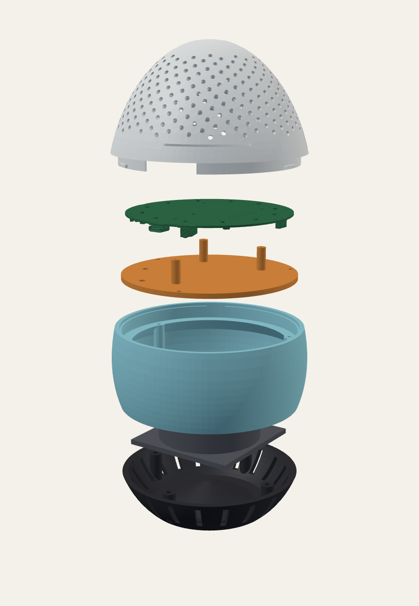

# Robin Egg enclosure, v1

A flat-bottomed egg, 137 mm tall and 120 mm wide, in four printed parts. `robin_egg.py` is the parametric source (CadQuery). Every dimension is a named constant at the top of the file. Change one, run it again, and you get fresh STLs and STEPs.

Board positions come from Seeed's STEP model (`reference/datasheets/3d/respeaker_mic_array_xvf3800_1_with-xiao-0820.stp`). Speaker positions come from Dayton's DMA70-4 drawing. Both were checked against the model for collisions. See "Fit checks" below.

## Parts

| File | What it is | Print |
| --- | --- | --- |
| `stl/foot.stl` | Flat bottom (76 mm across), deflector cone, 20 sound slots, 4 screw posts, rubber-foot recesses | Flat side down. No supports. Black or the body colour |
| `stl/body.stl` | Speaker baffle, sealed speaker chamber, the ledge the chassis sits on, the bayonet lip | Baffle down (the flat bottom face). No supports. Robin's-egg blue, or white for now. 3 to 4 walls, 20 % infill |
| `stl/chassis.stl` | Divider that seals the top of the speaker chamber, with 3 standoffs for the board | Flat side down. No supports. Any colour |
| `stl/crown.stl` | Twist-off top: speckle holes, mute flexure, reset pinhole, USB-C pocket, light-sensor window at the apex | Right way up, standing on its rim. The 2 mm wall leans in gently and prints without supports. White or translucent PETG/PLA, so the LEDs glow through |

`step/` has the same parts as STEP for Fusion, Onshape or FreeCAD. `robin_egg_assembly.step` has everything in place.

## How it opens

- **Crown (everyday access):** it twists off. Turn it about 30° anticlockwise, seen from above, and lift. To close it, drop it on with the three lugs in the three notches and turn it clockwise until it stops. A small arrow mark is not modelled yet. Mark the notch positions with a pen on the first print. Take the USB cable out first, because the plug sits in the crown's pocket.
- **Board:** with the crown off, take out the 3 M2 screws and lift the board. You only need this for the XMOS USB port (rare DFU flashing from safe mode).
- **Foot (speaker access):** 4 M3 screws from underneath. The speaker hangs from the underside of the baffle.

## Where things are

| Feature | Where | Notes |
| --- | --- | --- |
| USB-C | Back of the egg, at the seam, about 90 mm up | A normal USB-C cable plugs straight into the XIAO port through a pocket in the crown. Power and flashing use the same cable. The port is only about 5 mm inside the shell wall, so no extension lead fits inside |
| Mute | Right side (+x), at the seam | A flexing tab in the crown pushes the board's own side-push mute button. If the bench test shows mute is the other button, set `MUTE_SIDE = -1` and re-run |
| Reset | Left side, opposite mute | 1.8 mm pinhole for a paperclip |
| LEDs | Under the crown | The 12-LED ring at r = 40 mm glows through the white crown and its holes |
| Mics | Under the crown | Ports at (±33, ±33) mm. They hear through the speckle holes (380 holes of 2.6 mm, about 15 % open area) |
| Light sensor | Apex | 5 mm window. Glue in a clear plug or leave it open |
| Speaker | Fires down into the foot | Sound goes out through the slots. Glue acoustic fabric or thin speaker cloth inside the slots |

## Hardware

| Qty | Part | Use |
| --- | --- | --- |
| 4 | M3 heat-set insert, 4 mm OD, 5 mm long | Baffle underside, for the foot screws |
| 4 | M3 × 25 mm screw | Foot to body |
| 4 | M3 × 8 mm screw (self-tapping, or machine screw into the 2.8 mm pilot) | Speaker to baffle |
| 3 | M2.5 × 8 mm self-tapping screw | Chassis to body |
| 3 | M2 × 6 mm self-tapping screw | Board to standoffs |
| 3 | Rubber feet, 10 mm round, 1 to 2 mm tall | Foot recesses |
| 1 | 3 mm foam tape, or a bead of silicone | Seals the chassis on its ledge |
| | Polyester fill, a loose handful | Speaker chamber |
| | Acoustic fabric strip about 30 × 340 mm | Inside the foot slots |

## Assembly

1. Press the 4 M3 inserts into the underside of the body's baffle with a soldering iron.
2. Solder the JST pigtail to the speaker (red to +). Screw the speaker to the underside of the baffle, magnet up into the chamber, with the 4 M3 × 8 screws.
3. Loosely fill the chamber with polyester fill, keeping it off the speaker cone.
4. Put foam tape on the ledge. Thread the speaker pigtail up through the chassis hole near (−38, −14). Seat the chassis and fix it with the 3 M2.5 screws. Seal the wire hole with hot glue. The chamber is only airtight if this hole and the ledge are sealed.
5. Glue fabric inside the foot's slots. Screw the foot on with the 4 M3 × 25 screws, then stick on the rubber feet.
6. Set the board on the standoffs, LEDs and Seeed logo up, with the XIAO toward the back (+y). Fix it with the 3 M2 screws. Plug the speaker into the board's JST socket from underneath.
7. Twist the crown on. Plug in the USB-C cable at the back.

## Numbers

- Speaker chamber: about 0.31 L net. In a sealed box with the DMA70-4 that gives Qtc about 1.05 and a low cutoff about 270 Hz, which is fine for speech. To get more, raise `Z_LEDGE_TOP` and `Z_PCB` together, or grow the egg (`EGG_L`, `EGG_B`).
- Board plane: PCB underside at z = 93 mm. Shell inside diameter there is about 108 mm, so the 100 mm board plus its side buttons (103 mm) clears.
- Seam: z = 86 mm (73 mm above the table).

## Fit checks run

Run with `check.py` against Seeed's full board model (580 solids) and a DMA70-4 envelope from Dayton's drawing.

- Board vs body, chassis and crown, assembled: no overlap.
- Speaker vs foot, body and chassis: no overlap.
- Crown going on: checked with the crown lowered at the unlocked angle from 7 mm above, then twisted through 20°, 10° and 0° to locked. No contact with the board at any step, and the lugs pass the lip only through the notches. The 3.5 mm jack and the XMOS USB-C stick out past the board edge at the front, so the crown has a gap in its skirt and a groove in its wall there.
- Speaker chamber: 334 cm³ of air before the speaker (about 25 cm³) and fill, so about 0.31 L net. That is a little under the 0.35 L target and gives Qtc about 1.05 and a cutoff about 270 Hz. That is still fine for speech.

## Known limits of v1

- The mics sit about 20 mm under the crown. The speckle holes are a first guess. Print a crown with `PERF_N` and `PERF_D` turned up, and one with them down, and compare wake-word distance against the bare board.
- The bayonet lip catches the lugs by about 0.9 mm. That is enough for PLA. If it feels loose, make `LUG_R1` 0.3 mm bigger.
- No mount for the mmWave presence sensor yet. Its spot is the front wall of the crown, just above the seam, away from the XIAO antenna at the back.
- The XMOS USB port and the 3.5 mm jack are not reachable without lifting the board.
- Measure the real board, button and speaker against these numbers on the bench before a long print. A quick test is to print only the bottom 15 mm of the crown and the top 15 mm of the body to check the bayonet, the USB pocket and the mute tab.
