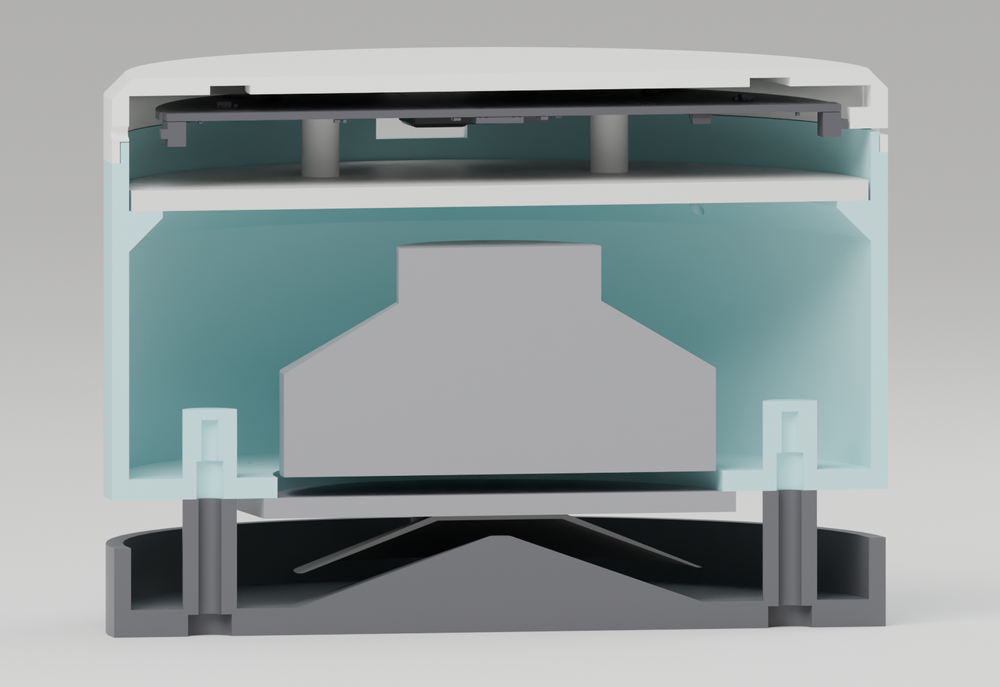

# Robin Egg enclosure, v2 squat cylinder

A short cylinder, 115 mm across and 81 mm tall, in four printed parts. `robin_cylinder.py` is the parametric source (CadQuery), with every dimension a named constant at the top. Run it again and it rewrites `stl/` and `step/`. The design and its reasoning are in [the design doc](../../docs/superpowers/specs/2026-11-17-squat-cylinder-enclosure-design.md).

This is the first-print version. The top pushes straight on instead of twisting, and there are no sensor mounts yet.

## Parts

| File | What it is | Print |
| --- | --- | --- |
| `stl/cylinder_body.stl` | Smooth sleeve, speaker baffle, sealed speaker chamber, ledge for the chassis, push-on lip with a key at the front | First. Flat bottom (the baffle) down, as saved. No supports. Blue, or white for now |
| `stl/cylinder_chassis.stl` | Plate that seals the top of the chamber, with 3 standoffs for the board | Flat side down. No supports. Any colour |
| `stl/cylinder_top.stl` | Push-on top: lid with 4 mic holes and bosses, thinned ring over the LEDs, mute flexure (+x), reset pinhole (−x), USB-C pocket (back) | **Flip it in the slicer** so the flat top face is on the bed. No supports. White, so the LEDs glow through |
| `stl/cylinder_base.stl` | Dark base band, deflector cone, 4 screw posts, rubber-foot recesses | Flat side down. No supports. Dark |

Print the body first, as it's the longest print and everything fits against it. Then the top, to try the push-on fit. If the top is too tight or too loose, change `LAP_CLEAR` and reprint only the top.

## Hardware

Same as the egg ([hardware table](../egg/README.md#hardware)), except there is no acoustic fabric:

- 4 × M3 heat-set inserts in the baffle bosses
- 4 × M3 × 25 screws, base to body
- 4 × M3 × 8 screws, speaker to baffle
- 3 × M2.5 × 6 self-tapping screws, chassis to ledge (× 8 works, with hot glue over the tips)
- 3 × M2 × 6 self-tapping screws, board to standoffs
- 3 rubber feet

## Assembly

Directions: the **front** is the side with the small key tab on the body's top lip. The **back** is the side with the USB-C notch, opposite it. **Right** (+x) is the right-hand side when you face the front.

Also on hand: silicone for the ledge (not thick foam tape, see step 4), hot glue, and a loose handful of polyester fill.

1. **Inserts.** Turn the body upside down. Press the 4 M3 heat-set inserts into the 4 holes around the big speaker hole, using a soldering iron.
2. **Speaker.**
   - Solder the JST pigtail to the speaker, red to +.
   - With the body still upside down, set the speaker over the big hole, cone facing you and magnet down into the body. **The square flange sits on the outside face of the body, not inside the box.** The magnet needs all of the box's height: it ends 3.4 mm under the chassis this way, and hits the chassis if the flange is inside.
   - Line its 4 corner holes up with the 4 small holes and fix it with the 4 M3 × 8 screws.
3. **Fill.** Turn the body upright. Loosely fill the chamber with polyester fill through the open top. Keep it loose.
4. **Chassis.**
   - Put a thin bead of silicone on the ledge inside the body. Don't use thick foam tape. It lifts the chassis, and the board with it, and the top's mic posts only clear the board by 0.6 mm.
   - Thread the speaker pigtail up through the chassis's wire hole. The hole is 8 mm so the JST plug fits through. A chassis printed before 2026-11-17 has a 4 mm hole: drill it out to 8 mm.
   - Drop the chassis onto the ledge, standoffs up. Turn it so the **single standoff points to the front and the pair to the back**. Only one of the three ways its screw holes line up is right, so check this.
   - Fix it with the 3 M2.5 screws. Use 6 mm ones if the kit has them. An 8 mm screw pokes about 1.5 mm into the box, so put a dab of hot glue over each tip.
   - Seal the wire hole with hot glue. The speaker box only works if it is airtight.
5. **Base.**
   - Set the body on the base so the 4 posts meet the 4 inserts. The cone sits under the speaker.
   - Screw them together from underneath with the 4 M3 × 25 screws.
   - Stick the 3 rubber feet in their recesses.
6. **Board.**
   - Plug the speaker into the board's JST socket first. The bay under the board is only 10 mm deep, so it is hard to reach afterwards.
   - Set the board on the standoffs, LED side up, with the XIAO's USB-C port facing the USB-C notch at the back.
   - Fix it with the 3 M2 × 6 screws.
7. **Top.**
   - Line up the slot inside the top's rim with the key tab at the front, and push it straight down.
   - That puts the mic holes over the mics, the mute tab on the right and the USB-C pocket at the back.
8. **USB-C.** Plug the cable into the port at the back.

To open it: unplug the USB-C cable, then pull the top straight up.

**Check the mute tab.** Press the flexing tab on the right side. The mute LED should go red. If the board resets instead, mute is the other button. Set `MUTE_SIDE = -1` in `robin_cylinder.py`, run it, and reprint only the top.

## Fit checks run

`check_cylinder.py` checks the parts against Seeed's board model and a DMA70-4 envelope.

- Board against body, chassis and top: no clashes.
- Speaker against base, body and chassis: no overlap.
- Parts against each other: no overlap.
- Speaker chamber: 0.36 L of air, about 0.34 L once the speaker is in.
