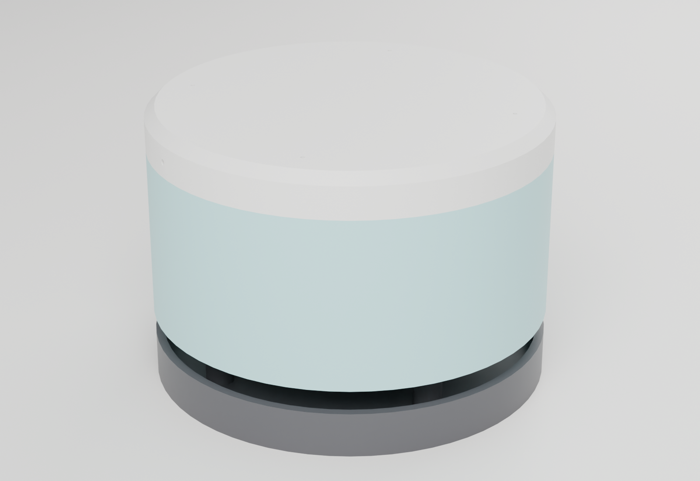
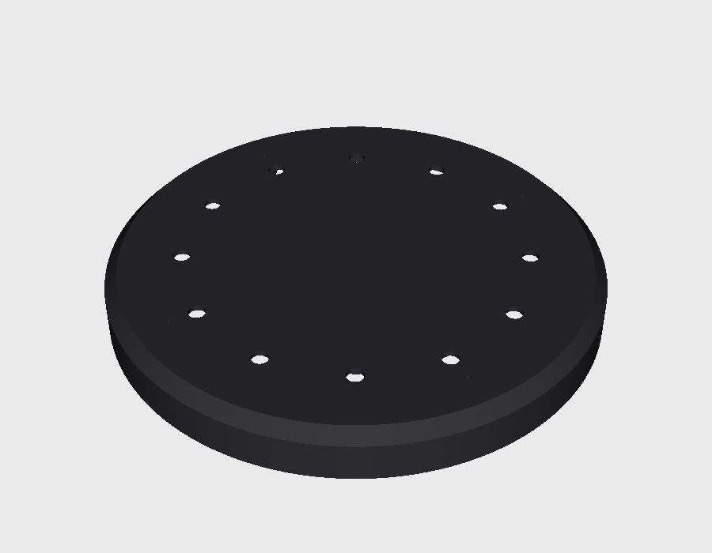

# Robin Egg enclosure, v2 squat cylinder

A short cylinder, 115 mm across and 81 mm tall, in four printed parts. `robin_cylinder.py` is the parametric source (CadQuery), with every dimension a named constant at the top. Run it again and it rewrites `stl/` and `step/`. The design and its reasoning are in [the design doc](../../docs/superpowers/specs/2026-11-17-squat-cylinder-enclosure-design.md).

This is the first-print version. The top pushes straight on instead of twisting, and there are no sensor mounts yet. The first one was printed in black and assembled on 2026-11-19. See "Notes for the next version" below.

## Parts

| File | What it is | Print |
| --- | --- | --- |
| `stl/cylinder_body.stl` | Smooth sleeve, speaker baffle, sealed speaker chamber, ledge for the chassis, push-on lip with a key at the front | First. Flat bottom (the baffle) down, as saved. No supports. Blue, or white for now |
| `stl/cylinder_chassis.stl` | Plate that seals the top of the chamber, with 3 standoffs for the board | Flat side down. No supports. Any colour |
| `stl/cylinder_top.stl` | Push-on top: lid with 4 mic holes in posts that reach down to the board, thinned ring over the LEDs, mute flexure (+x), reset pinhole (−x), USB-C pocket (back) | **Flip it in the slicer** so the flat top face is on the bed. No supports. White, so the LEDs glow through |
| `stl/cylinder_top_holes.stl` | The same top for filament that blocks light, such as black: 12 holes of 4 mm, one over each LED, and 6 crush ribs inside the rim for a firmer fit | As the top: **flip it** so the flat face is on the bed. No supports. Any colour |
| `stl/cylinder_base.stl` | Dark base band, deflector cone, 4 screw posts, rubber-foot recesses | Flat side down. No supports. Dark |

Print the body first, as it's the longest print and everything fits against it. Then the top, to try the push-on fit. If the top is too tight or too loose, change `LAP_CLEAR` and reprint only the top.

## Hardware

Same as the egg ([hardware table](../egg/README.md#hardware)), except there is no acoustic fabric:

- 4 × M3 heat-set inserts in the baffle bosses
- 4 × M3 × 25 screws, base to body
- 4 × M3 × 8 screws, speaker to baffle
- 3 × M2.5 × 6 self-tapping screws, chassis to ledge (× 8 works, with hot glue over the tips)
- 3 × M2 × 6 self-tapping screws, board to standoffs
- 3 rubber feet

## Assembly

Directions: the **front** is the side with the small key tab on the body's top lip. The **back** is the side with the USB-C notch, opposite it. **Right** (+x) is the right-hand side when you face the front.

Also on hand: silicone for the ledge (not thick foam tape, see step 4), hot glue, and a loose handful of polyester fill.

1. **Inserts.** Turn the body upside down. Press the 4 M3 heat-set inserts into the 4 larger (4 mm) holes, at the front, back, left and right of the big speaker hole, using a soldering iron. Leave the 4 smaller holes on the diagonals alone: those take the speaker screws.
2. **Speaker.**
   - Solder the JST pigtail to the speaker, red to +.
   - With the body still upside down, set the speaker over the big hole, cone facing you and magnet down into the body. **The square flange sits on the outside face of the body, not inside the box.** The magnet needs all of the box's height: it ends 3.4 mm under the chassis this way, and hits the chassis if the flange is inside.
   - Line its 4 corner holes up with the 4 small diagonal holes and fix it with the 4 M3 × 8 screws, driven straight into the plastic.
3. **Fill.** Turn the body upright. Loosely fill the chamber with polyester fill through the open top. Keep it loose.
4. **Chassis.**
   - Put a thin bead of silicone on the ledge inside the body. Don't use thick foam tape. It lifts the chassis, and the board with it, and the top's mic posts only clear the board by 0.1 mm.
   - Thread the speaker pigtail up through the chassis's wire hole. The hole is 8 mm so the JST plug fits through. A chassis printed before 2026-11-17 has a 4 mm hole: drill it out to 8 mm.
   - Drop the chassis onto the ledge, standoffs up. Turn it so the **single standoff points to the front and the pair to the back**. Only one of the three ways its screw holes line up is right, so check this.
   - Fix it with the 3 M2.5 screws. Use 6 mm ones if the kit has them. An 8 mm screw pokes about 1.5 mm into the box, so put a dab of hot glue over each tip.
   - Seal the wire hole with hot glue. The speaker box only works if it is airtight.
5. **Base.**
   - Set the body on the base so the 4 posts meet the 4 inserts. The cone sits under the speaker.
   - Screw them together from underneath with the 4 M3 × 25 screws.
   - Stick the 3 rubber feet in their recesses.
6. **Board.**
   - Plug the speaker into the board's JST socket first. The bay under the board is only 10 mm deep, so it is hard to reach afterwards.
   - Set the board on the standoffs, LED side up. Its 3 holes form a triangle: put the **lone hole on the single standoff at the front** and the two close-together holes on the pair at the back. The board has two USB-C ports. The one at the triangle's point, beside the headphone jack, is the board's own and goes at the front. The one that must face the USB-C notch at the back is on the XIAO, the small module soldered underneath.
   - Fix it with the 3 M2 × 6 screws.
7. **Top.**
   - Line up the slot inside the top's rim with the key tab at the front, and push it straight down.
   - That puts the mic holes over the mics, the mute tab on the right and the USB-C pocket at the back.
8. **USB-C.** Plug the cable into the port at the back.

To open it: unplug the USB-C cable, then pull the top straight up.

**Check the mute tab.** Press the flexing tab on the right side. The mute LED should go red. If the board resets instead, mute is the other button. Set `MUTE_SIDE = -1` in `robin_cylinder.py`, run it, and reprint only the top.

## Notes for the next version

From the first assembly, 2026-11-19. Everything fitted once the speaker was mounted as described.

- **Print the body in matte robin's-egg blue** (about `#ADE5E7`, as in the renders). The first one was black.
- **Print the top in white or translucent filament.** The LEDs work, but they don't show through a black top at all, even over the 1.2 mm ring. Black blocks the light at any thickness. The body and base can stay any colour.
- **Until the white filament arrives, print `cylinder_top_holes.stl`.** It has a 4 mm hole over each of the 12 LEDs, so they show through a black top. First printed in black on 2026-11-21.
  - The bare LEDs show as 12 sharp points. For soft dots, lay a ring of baking paper or frosted tape in the channel on the underside (37 to 43 mm from the centre).
  - It also carries the crush ribs described below, as their first trial. If it goes on too tight, lower `RIB_PRESS` and reprint. If the ribs work, turn them on for the plain top too: `make_top(crush_ribs=True)`.

  
- **Make the top hold on more firmly.** The push-on top sits loosely and doesn't pop on. Two ways:
  - **Top only:** about 6 small vertical crush ribs inside the top's rim, each pressing about 0.2 mm into the body's lip. Gives a firm friction fit, but no click.
  - **Top and body:** a groove round the body's lip and bumps in the top that snap into it, or the twist lock from the design doc. Gives a real click, but needs a new body.
- **Reprint the top for the mics.** With the first top on, speech-to-text got questions wrong that it got right with the top lifted off. Captures on 2026-11-21 showed why: speech from 1 to 2 kHz was 12 to 22 dB weaker with the top on. Each mic post stopped 0.6 mm above the board, so the mic heard the air inside the top more than the room, through a hole only 1.2 mm wide.
  - Both tops now have posts that end 0.1 mm above the board and holes of 2 mm. No gasket is needed.
  - If a print comes out tall, the posts rest on the board and the top sits a fraction of a millimetre high. That is fine.
  - Test it by asking the same question with the top on and off, with the server's `--save-audio` on, and comparing the captures. If the top still muffles speech, add a ring of 1 mm closed-cell foam on each post and raise `MIC_BOSS_GAP` to about 0.7.
- **Seal the speaker chamber.** The first assembly used screws only: no silicone on the ledge, no hot glue in the wire hole and no fill. The chamber leaks into the bay under the board, where the mics are. Seal it as the assembly steps describe.
- **Mute tab not tested yet.** If pressing it resets the board instead of muting, set `MUTE_SIDE = -1`. Fold that into the same top reprint.
- **The steps confused three things,** now spelled out above:
  - which side the speaker's square plate goes on
  - which holes take the inserts and which take the speaker screws
  - which of the board's two USB-C ports faces the back notch

## Fit checks run

`check_cylinder.py` checks the parts against Seeed's board model and a DMA70-4 envelope.

- Board against body, chassis and both tops: no clashes.
- Holed top: all 12 LEDs sit under a hole, and it touches the body only at the 6 crush ribs.
- Both tops: all 4 mics have a clear hole, and the posts end 0.1 mm above the board.
- Speaker against base, body and chassis: no overlap.
- Parts against each other: no overlap.
- Speaker chamber: 0.36 L of air, about 0.34 L once the speaker is in.
